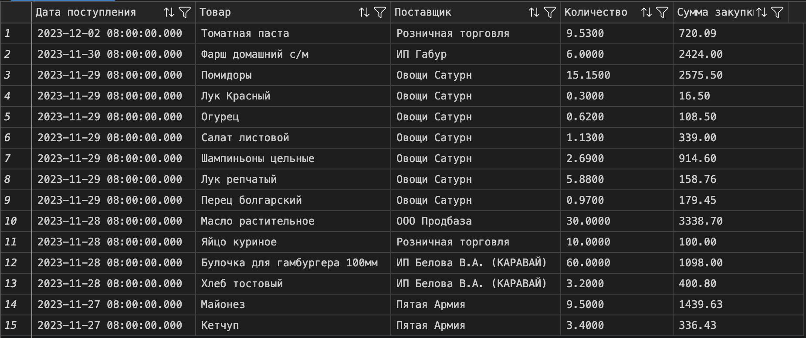
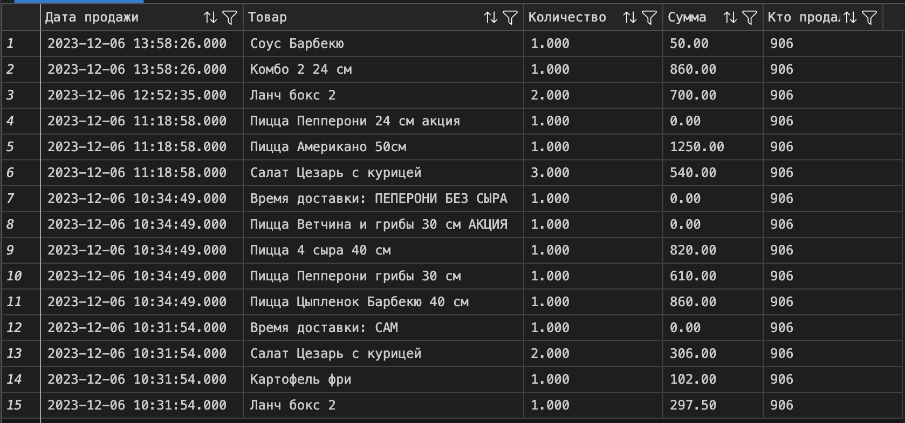
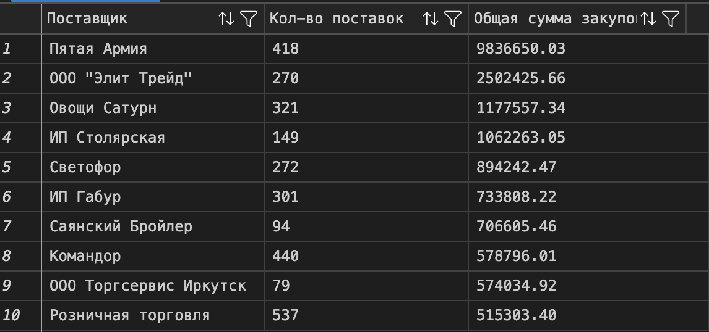
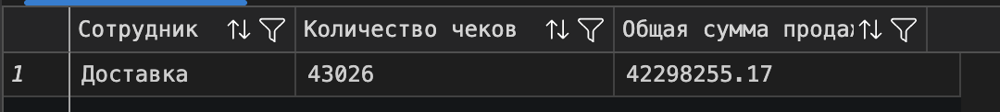
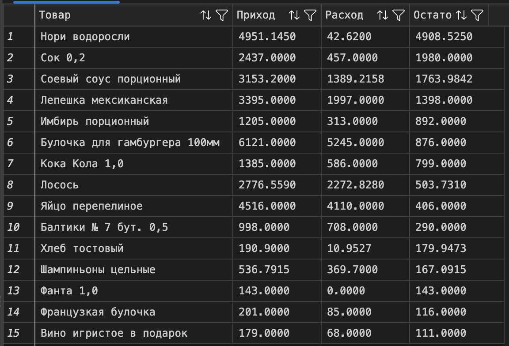

# Анализ базы Front

## 1. Закупки

Таблицы: `bm_StorageOperations`, `product`, `vendors`, `bm_JournalBarnetDocs`.

`OperationID = 1` — поступление, `DocumentTypeID = 4` — «Поступление продуктов». Дата берётся из документа (`d.Period`), а не из `o.DateAdd` — там время импорта.

```sql
SELECT TOP 15
    d.Period AS "Дата поступления",
    p.description AS "Товар",
    v.firstname AS "Поставщик",
    o.Count AS "Количество",
    o.Amount AS "Сумма закупки"
FROM dbo.bm_StorageOperations o
JOIN dbo.product p ON p.id = o.ProductID
JOIN dbo.vendors v ON v.id = o.VendorID
JOIN dbo.bm_JournalBarnetDocs d ON d.ID = o.DocumentID
WHERE o.OperationID = 1 AND d.DocumentTypeID = 4
ORDER BY d.Period DESC;
```



## 2. Продажи

Таблицы: `journal`.

`101` — обычные продажи, `111` — весовые (в базе тоже проходят как продажи). `status = 0` — без сторнированных строк.

```sql
SELECT TOP 15
    j.dater AS "Дата продажи",
    j.description AS "Товар",
    j.quantity AS "Количество",
    j.amount AS "Сумма",
    j.loginid AS "Кто продал"
FROM dbo.journal j
WHERE j.transtype IN (101, 111) AND j.status = 0
ORDER BY j.dater DESC;
```



## 3. Поставщики

Таблицы: `bm_StorageOperations`, `vendors`, `bm_JournalBarnetDocs`.

Группировка по `v.id`, а не по имени: в `vendors` есть записи с одинаковым названием.

```sql
SELECT TOP 10
    v.firstname AS "Поставщик",
    COUNT(DISTINCT o.DocumentID) AS "Кол-во поставок",
    SUM(o.Amount) AS "Общая сумма закупок"
FROM dbo.bm_StorageOperations o
JOIN dbo.vendors v ON v.id = o.VendorID
JOIN dbo.bm_JournalBarnetDocs d ON d.ID = o.DocumentID
WHERE o.OperationID = 1 AND d.DocumentTypeID = 4
GROUP BY v.id, v.firstname
ORDER BY "Общая сумма закупок" DESC;
```



## 4. Персонал

Таблицы: `journal`, `personnel`.

Соединение по числам (`personid` — int, `loginid` — varchar). В этом дампе все продажи записаны на `loginid = 906`, поэтому в результате одна строка.

```sql
SELECT TOP 10
    p.firstname AS "Сотрудник",
    COUNT(DISTINCT j.receiptn) AS "Количество чеков",
    SUM(j.amount) AS "Общая сумма продаж"
FROM dbo.journal j
JOIN dbo.personnel p ON p.personid = TRY_CAST(j.loginid AS int)
WHERE j.transtype = 101 AND j.status = 0
GROUP BY p.personid, p.firstname
ORDER BY "Общая сумма продаж" DESC;
```



## 5. Остатки

Таблицы: `bm_StorageOperations`, `product`.

`Count` уже хранится со знаком: приход положительный, списание отрицательное. Поэтому остаток — просто `SUM(Count)`, а не «приход минус минус-расход».

```sql
SELECT TOP 15
    p.description AS "Товар",
    SUM(CASE WHEN o.OperationID = 1 THEN o.Count ELSE 0 END) AS "Приход",
    SUM(CASE WHEN o.OperationID = 2 THEN -o.Count ELSE 0 END) AS "Расход",
    SUM(o.Count) AS "Остаток"
FROM dbo.bm_StorageOperations o
JOIN dbo.product p ON p.id = o.ProductID
GROUP BY p.id, p.description
HAVING SUM(o.Count) > 0
ORDER BY "Остаток" DESC;
```


